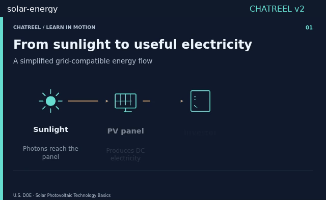
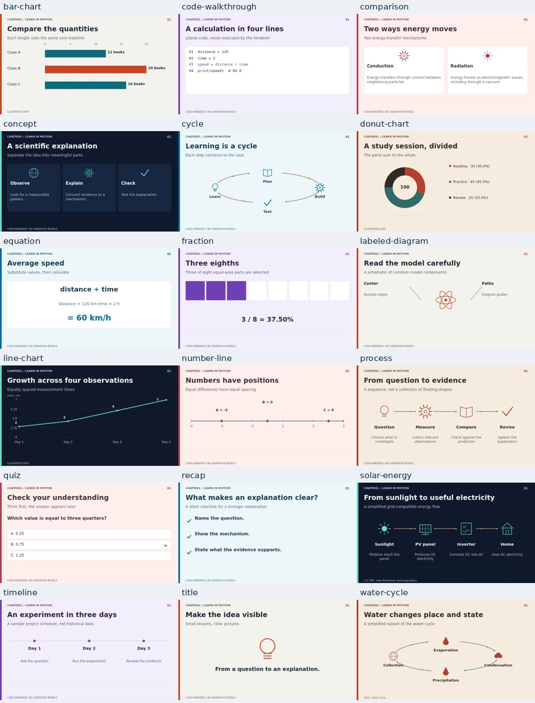

<div align="center">

# Chatreel

**Educational videos rendered through code. No generative models.**

18 lesson templates · six new themes · Python and Canvas · 1080p delivery

[](https://github.com/yashmgupta/chatreel/raw/refs/heads/main/gpt/chatreel-offline.zip)
[](examples/education/solar-lesson.mp4)

[](https://github.com/yashmgupta/chatreel/actions/workflows/tests.yml)
[](LICENSE)
[](ATTRIBUTION.md)
[](renderer-py/)
[](https://github.com/yashmgupta/chatreel/stargazers)

[Use in ChatGPT](#start-here--make-a-film-in-a-chatgpt-chat) · [Templates](#18-educational-templates) · [Render locally](#render-locally) · [Host an Action](#self-host-the-gpt-action) · [Evidence](docs/V2-VALIDATION.md)



*Actual renders, not concept art. Diagrams are simplified teaching illustrations.*

</div>

Make explainers with labelled processes, proportional charts, checked arithmetic, equal-area fractions, quizzes and readable captions. Every frame and musical note comes from conventional code. Rendering requires no model weights, inference API, image/video generation or stock footage. ChatGPT can help draft the script; it is not the pixel-generation engine.

The original five style ports were adapted from **[Lemomo/LemoLab's Lemo-Opuscar](https://github.com/lemomo-ai/lemo-opuscar)**. The new educational scene compiler and templates are original Chatreel code. [Attribution and licenses](ATTRIBUTION.md) are retained. [Research notes](docs/RENDERER-RESEARCH.md) explain what we learned from Manim, MoviePy, drawsvg and imageio-ffmpeg.

## Start here — make a film in a ChatGPT chat

No local coding or Custom GPT setup is required for this route. You need file uploads and **Code Interpreter / Data Analysis** in your ChatGPT session.

1. **[Download the ChatGPT upload ZIP](https://github.com/yashmgupta/chatreel/raw/refs/heads/main/gpt/chatreel-offline.zip).** Keep it zipped.
2. Attach it to a new ChatGPT conversation.
3. Send the guided prompt below. ChatGPT will ask about your idea one question at a time, then turn your answers into a reusable video prompt and storyboard.
4. Review the storyboard and reply **“Confirm, render it”**. ChatGPT should return a real downloadable MP4 if its sandbox has a working encoder.

```text
Help me make an educational video with Chatreel. First ask what I want to
explain and what viewers should learn. Ask one short question at a time
for the remaining audience, key points/sources, length/platform, look,
language and sound. Offer simple choices and let me say “choose for me.”
Skip anything I already answered.

Use my answers to write a reusable Video production prompt and a timed
storyboard using supported Chatreel templates. Keep facts, labels, units
and calculations accurate; mark illustrative data and unverified claims.
Use conventional code only, with no image/video generation models.

Show me the prompt and storyboard and wait for my explicit confirmation
before rendering. Update them if I ask for changes. When I confirm, use
the attached package, check capabilities, validate the film JSON, render,
and inspect the real outputs. If I only want a reusable prompt, stop there.

Start with the first question about my topic and learning objective.
```

**Just want a prompt first?** You can start the interview without uploading anything. Use the [full starter prompt](gpt/start-here.md). ChatGPT should produce your personalized brief and storyboard; upload the ZIP when you are ready to render.

**A repository link alone is not enough to run the renderer.** Browsing availability varies, and Code Interpreter cannot download the code from the internet. Upload the ZIP into the chat; a README uploaded by itself contains instructions but no engine. If file uploads/Data Analysis are unavailable, use a compatible session or run locally.

Offline mode has no browser, WebGL or TTS. You can attach your own narration recording and ask ChatGPT to pass its local path as `voice_path`. If no encoder is available, the renderer exports PNG frames, WAV and SRT and explicitly reports that it could not create an MP4.

## 18 educational templates



| Family | Templates | What is checked |
|---|---|---|
| Explain an idea | `title`, `concept`, `labeled-diagram`, `recap` | Explicit labels, readable bounds, no text collisions |
| Explain a sequence | `process`, `cycle`, `timeline` | Supplied order, directional connectors, deterministic motion |
| Compare quantities | `bar-chart`, `line-chart`, `donut-chart`, `comparison` | Proportional geometry, shared scales, nonnegative parts where required |
| Teach mathematics | `equation`, `number-line`, `fraction` | Restricted Decimal arithmetic, positioned values, equal-area cells |
| Explain a mechanism | `solar-energy`, `water-cycle` | Meaningful named components and documented simplifications |
| Practice and demonstrate | `quiz`, `code-walkthrough` | Delayed answer reveal, explicit correct option, preserved code indentation |

**[Browse the runnable template JSONs](templates/)** · **[View Python and Canvas test clips](examples/education/templates/)**

Themes: `studio`, `midnight`, `paper`, `ocean`, `coral`, `violet`. Five legacy palettes/styles—`swiss-motion`, `blueprint`, `chalkboard`, `woodcut`, `pixel-rpg`—also remain available. Legacy object scenes still work. Applying a legacy palette to a new template does not reproduce its full original material engine.

Template examples include reading holds. The five-second test clips are QA samples, not recommended pacing for every full lesson. The renderer reports a heuristic recommended reading duration; review it with your audience in mind.

## Render locally

Python 3.11+, Pillow, numpy and ffmpeg are sufficient. Fonts are bundled. No Manim, browser, model or internet is needed during Python rendering.

```sh
git clone https://github.com/yashmgupta/chatreel.git
cd chatreel
python -m venv .venv
. .venv/bin/activate
pip install -r renderer-py/requirements.txt
# Install ffmpeg/ffprobe with your OS package manager.

python renderer-py/render.py --capabilities
python renderer-py/render.py --templates
python renderer-py/render.py --template solar-energy --theme ocean --preflight
python renderer-py/render.py --template solar-energy --theme ocean \
  --profile production --out artifacts/solar
python renderer-py/render.py --template fraction --aspect portrait \
  --out artifacts/fraction
python renderer-py/render.py examples/education/solar-lesson.json \
  --out artifacts/lesson
```

For custom content, edit a template JSON. The schema is shared by both modes. New scenes use `template` and `content`; old scenes use `objects`. Do not mix both in one scene.

```json
{
  "title": "Average speed",
  "style": "studio",
  "profile": "production",
  "scenes": [{
    "template": "equation",
    "title": "Distance divided by time",
    "duration": 9,
    "content": {
      "expression": "distance / time",
      "variables": {"distance": 120, "time": 2},
      "variable_units": {"distance": "km", "time": "h"},
      "result": 60,
      "unit": "km/h"
    }
  }]
}
```

`production` defaults to **1920×1080 at 30 fps**. `preview` retains smaller defaults; bundled templates explicitly use 1280×720. `--aspect portrait` or `square` selects a matching layout. All scene durations must align to whole frames. Limits: 120 seconds, 3600 frames, six billion pixel-frames in production / 1.5 billion in preview, and maximum 1920 pixels per dimension. Maximum dimensions, duration and fps cannot all be combined.

The engine compiles a scene once, uses deterministic easing and caches settled static layers. Python and Canvas evaluate the same drawing commands. Text is measured against bundled fonts; overflow, collisions and unsupported glyphs fail preflight rather than disappearing or shrinking to unreadable sizes. SVG snapshots and inspectable numerical metrics come from the same scene.

Outputs include `film.mp4`, `film.json`, `film.srt`, `mix.wav`, `master.wav`, `poster.png`, `contact-sheet.jpg`, `quality.json`, `scene-metrics.json`, `SOURCES.json`, `scene-*.svg` and `CREDITS.txt` when applicable. ffmpeg uses H.264/AAC, explicit BT.709 limited-range conversion, fast-start MP4 and two-pass loudness normalization. ffprobe checks actual frame count, dimensions, duration and streams. MoviePy is an optional encoding fallback; its audio normalization is reported as unmeasured when system ffmpeg is unavailable.

### Python / Code Interpreter API

After extracting the upload ZIP:

```python
import json, sys
from pathlib import Path
sys.path.insert(0, '/mnt/data/chatreel/renderer-py')  # adjust extraction path
import render
print(render.capabilities())
film = json.loads(Path('/mnt/data/chatreel/templates/equation.json').read_text())
result = render.render_film(film, '/mnt/data/my-film')
# Optional: voice_path='/mnt/data/uploaded-recording.wav'
print(result)
```

`Scene.render(t)` takes local scene seconds. `FilmRenderer.frame(t)` takes global film seconds and retains compiled layouts. `validate(film)` runs schema and semantic/layout checks. The renderer never installs or downloads at runtime. Without ffmpeg, uploaded voice must be mono PCM16 WAV at 24 kHz; with ffmpeg other locally decodable formats work. Recording alignment is the caller's responsibility.

## Create a Custom GPT

1. Paste `gpt/instructions.md` into Instructions (under 8,000 characters).
2. Enable Code Interpreter & Data Analysis.
3. Upload `film-schema.json` plus `gpt/knowledge/DIRECTOR.md`, `TECHNIQUE.md`, `EDUCATION.md` and `BRIEFING.md` as knowledge. `SUPPORTED-STYLES.md` is optional for old-style requests. Do not upload all 66 upstream reference prompts individually.
4. For offline use, users attach `gpt/chatreel-offline.zip` in the conversation. Rebuild it with `python tools/package_offline.py` after changing bundled files.
5. To avoid the per-conversation ZIP upload, deploy the server below and add it as an Action. Import `openapi.yaml`, replace `https://render.example.com` with your HTTPS origin, select custom API-key header **X-API-Key**, and enter the key securely. Provide your own privacy policy if publishing the GPT.

No public render service or already-configured GPT is included. ChatGPT libraries and execution budgets vary; the local/Docker checks do not guarantee every sandbox can finish a full-HD film.

## Self-host the GPT Action

The server uses FastAPI, a persistent SQLite job queue, sandboxed Chromium, the shared scene compiler, conventional eSpeak speech, procedural audio and ffmpeg. eSpeak is optional formant synthesis, not a neural model or cloned voice.

```sh
docker build -f server/Dockerfile -t chatreel .
python -c "import secrets; print('RENDER_API_KEY='+secrets.token_urlsafe(32))" > .env
# Add PUBLIC_BASE_URL=https://your-real-https-origin to .env; protect the file.
docker volume create chatreel-data
docker run --rm --name chatreel --init --env-file .env \
  --cpus=2 --memory=2g --pids-limit=256 --shm-size=256m \
  --security-opt seccomp=server/chromium-seccomp.json \
  -p 127.0.0.1:8000:8000 -v chatreel-data:/data chatreel
```

Use an HTTPS reverse proxy with a 64 KiB body limit and request timeouts. The bundled Playwright seccomp profile permits Chromium namespace syscalls while keeping a default-deny policy. Chromium's internal sandbox remains enabled; the host must also permit its namespaces. A managed custom-CA environment can build with `--secret id=ca_bundle,src=/etc/ssl/certs/ca-certificates.crt`.

| Endpoint | Result |
|---|---|
| `GET /templates` | 18 semantic templates, themes, profiles and accuracy limits |
| `GET /styles` | Available style/theme IDs and resource limits |
| `POST /render` | Validate JSON, enqueue and return 202 with job ID |
| `GET /jobs/{job_id}` | Status, errors/reading warnings, and signed download URL on completion |
| `GET /jobs/{job_id}/download` | MP4 using API key or a short-lived signed ticket |

All endpoints require `X-API-Key`, except a valid signed download link. Links expire after 15 minutes. Artifacts expire after 24 hours. Defaults: eight queued/running jobs, 300-second deadline, 512 MiB/job and 2 GiB total storage cap. Configure `JOB_DIR`, `RENDER_TIMEOUT`, `JOB_TTL`; complex HD jobs may need a longer deadline. One Uvicorn worker per job directory is enforced. Deadlines kill job subprocess groups; interrupted running jobs fail on restart and queued jobs survive. No rendering-time outbound network is needed.

This is a single-machine queue, not multi-tenant hosting. A shared key can access known job IDs. Use separate trust groups/deployments and operator rate limiting. Avoid logging signed URL query strings. Inspect per-job `worker.log` for detailed failures. No user Python, JavaScript, HTML, asset URLs or filesystem paths are accepted by the Action.

Native development: install `server/requirements.txt`, Chromium, ffmpeg and eSpeak NG; set `CHROMIUM_EXECUTABLE`, `RENDER_API_KEY`, `PUBLIC_BASE_URL`, then run `uvicorn server.app:app --host 127.0.0.1 --port 8000 --workers 1 --no-access-log`.

## What “accurate” means here

The renderer checks arithmetic, numbers-to-geometry mappings, input consistency, font/layout bounds and encoded file properties. It **does not verify arbitrary scientific facts, source URLs or dimensional analysis**. Supply trustworthy material and review publication content with subject expertise. Example data is visibly marked illustrative; source URLs are recorded without being fetched.

Solar-energy is a simplified energy-flow explanation, not wiring instructions. Water-cycle shows selected processes, not a complete hydrological simulation. Icons are schematic; the atom symbol does not depict literal electron orbits. Supported arithmetic is deliberately small and accepts no executable expressions. Bundled fonts have limited script coverage; unsupported glyphs fail clearly. SVG viewers need the corresponding DejaVu fonts for matching text metrics.

## Validation and development

See [v2 validation](docs/V2-VALIDATION.md), [per-template encoded audit](docs/education-audit.json), [original analysis](docs/ANALYSIS.md) and [renderer research](docs/RENDERER-RESEARCH.md).

```sh
pip install -r server/requirements.txt -r tests/requirements.txt
python -m unittest discover -s tests -v
# Offline-only checks:
python -m unittest discover -s tests -p test_render.py -v
python -m unittest discover -s tests -p test_education.py -v
# Review clips (5 seconds each, not full reading holds):
python tools/render_education.py
CHROMIUM_EXECUTABLE=/usr/bin/chromium python tools/render_education.py --backend canvas
python tools/package_offline.py
```

Full tests need sandbox-capable Chromium and eSpeak. CI runs Python checks and a Docker browser/TTS smoke render; consult its actual status badge. Five legacy styles remain covered by regression tests and their [original examples](examples/styles/).

If Chatreel helps you, star the repository, [share a film](https://github.com/yashmgupta/chatreel/issues/new?template=showcase.yml), [report a problem](https://github.com/yashmgupta/chatreel/issues/new?template=bug_report.yml), or [contribute](CONTRIBUTING.md). [Adding a style](styles/ADDING.md) and the [roadmap](ROADMAP.md) explain the intended scope.
