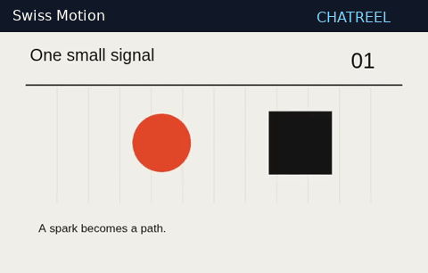
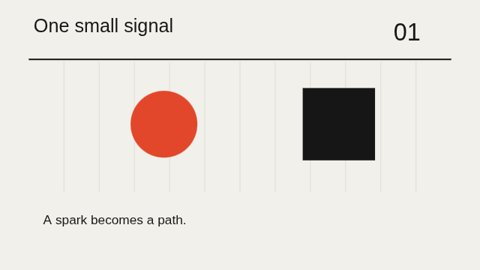

<div align="center">

# Chatreel

**Turn a ChatGPT conversation into a short, code-rendered film.**

Storyboard → confirm → render → download your MP4.

[](https://github.com/yashmgupta/chatreel/raw/refs/heads/main/gpt/chatreel-offline.zip)
[](https://github.com/yashmgupta/chatreel/blob/main/examples/story.mp4)

[](LICENSE)
[](ATTRIBUTION.md)
[](renderer-py/)
[](docs/VALIDATION.md)
[](https://github.com/yashmgupta/chatreel/stargazers)

[Start in ChatGPT](#start-here--make-a-film-in-a-chatgpt-chat) · [Five styles](#five-styles-you-can-render-today) · [Self-host the Action](#mode-b--action-render-service) · [Contribute](CONTRIBUTING.md)



*Actual clips from the included renderer. Compact geometric style ports, not video-generation models.*

</div>

Make short explainers, visual lessons and simple animated stories with **Python-rendered graphics and original procedural music**. Start with a ZIP uploaded into a ChatGPT Data Analysis session, or connect a Custom GPT to your own render server. No stock footage or video-generation model is used. ChatGPT feature availability varies by session.

Adapted from **[Lemomo/LemoLab's Lemo-Opuscar](https://github.com/lemomo-ai/lemo-opuscar)**, with attribution and original licenses retained. These five ports interpret selected visual rules rather than reproduce the full upstream engines.

| Pick your route | What you need | What you get |
|---|---|---|
| **ChatGPT + uploaded ZIP** | File uploads and Data Analysis | Offline 2D rendering, captions or your uploaded narration |
| **Custom GPT + Action** | Your deployed HTTPS render server | Chromium rendering, simple synthetic speech, optional WebGL compositing |

**New here?** Start with the ZIP route below. Hosting a server is optional.

## Start here — make a film in a ChatGPT chat

**No coding or Custom GPT setup is needed for this route.** You need a ChatGPT session with file uploads and Code Interpreter / Data Analysis available.

1. **[Download the ChatGPT upload ZIP](https://github.com/yashmgupta/chatreel/raw/refs/heads/main/gpt/chatreel-offline.zip).** Keep it zipped.
2. Open a new ChatGPT conversation and **attach that ZIP** using the file-upload button.
3. Copy the prompt below, change the topic if you like, and send it.
4. Review the storyboard. Reply **“Confirm, render it”** when you are happy. ChatGPT should return a downloadable MP4 if its sandbox has a working encoder.

```text
Use the attached Chatreel ZIP to make a code-rendered short film.
Extract it, read its README and ATTRIBUTION.md, and use its included
renderer-py/render.py and film-schema.json. Check render.capabilities()
before starting; do not attempt internet downloads or package installs.

Topic: How solar panels turn sunlight into electricity.
Length: 15 seconds.
Style: blueprint.
Voice: subtitles only, with original procedural music.

First show me a short storyboard with scene timings, visuals and captions.
Wait for my explicit confirmation before rendering. Then validate the film
JSON, use the included renderer, inspect representative frames, and return
the actual MP4 download plus the film JSON and subtitles. If MP4 encoding
is unavailable, explain the limitation and provide the generated artifacts.
Keep the package's attribution and license notices when sharing source.
```

**Change the style:** `swiss-motion` (graphic grid), `blueprint` (technical drawing), `chalkboard` (drawn lesson), `woodcut` (carved print), or `pixel-rpg` (game-like pixels). For your own narration, attach a recording too and ask ChatGPT to mix it using the local `voice_path` option. Offline rendering does not synthesize speech.

**Can I just paste this repository link into ChatGPT?** You can share https://github.com/yashmgupta/chatreel so people can find these steps. A link alone does not install or run the renderer: browsing availability varies, and Code Interpreter cannot download the package from the internet. Uploading the ZIP makes the source available inside the rendering sandbox. Uploading only the README explains the workflow but does not provide the renderer. If uploads or Data Analysis are unavailable in that session, use a compatible session or run the project locally.

For a shared experience where people only open your GPT and describe a film, configure a Custom GPT **with the hosted render Action** described below. That requires deploying the server and connecting its HTTPS endpoint; this repository does not include an already-hosted service.

## Five styles you can render today

Every preview below comes from a checked-in MP4. Click a frame to open its five-second test clip; the accompanying JSON is editable.

| Style | Rendered preview | Try it for |
|---|---|---|
| **Swiss Motion** | [](examples/styles/swiss-motion/server.mp4) | Graphic explainers and minimal motion posters |
| **Blueprint** | [](examples/styles/blueprint/server.mp4) | Simple engineering and process lessons |
| **Chalkboard** | [](examples/styles/chalkboard/server.mp4) | Classroom-style visual explanations |
| **Woodcut** | [](examples/styles/woodcut/server.mp4) | Restrained print-like visual stories |
| **Pixel RPG** | [](examples/styles/pixel-rpg/server.mp4) | Game-like messages and small journeys |

[Browse all example scripts and MP4s](examples/) · [See decoded frame comparisons](examples/server-contact-sheet.jpg) · [Read the validation evidence](docs/VALIDATION.md)

## Create the Custom GPT

1. In ChatGPT, create a GPT and paste `gpt/instructions.md` into Instructions (under 8,000 characters).
2. Enable **Code Interpreter & Data Analysis** for offline rendering. Upload `film-schema.json`, `gpt/knowledge/DIRECTOR.md`, `gpt/knowledge/TECHNIQUE.md` and `gpt/knowledge/SUPPORTED-STYLES.md` as knowledge. These four small files are the recommended retrieval set. Individual condensed prompts for every upstream style live under `gpt/knowledge/styles/`; unsupported ones are reference only. Do not upload all 66 individually (knowledge file limits vary).
3. Download the ready-to-upload `gpt/chatreel-offline.zip` (or rebuild with `python tools/package_offline.py`). Attach that ZIP to the rendering conversation as a normal file upload. Knowledge retrieval is not a reliable filesystem for source code. The user must provide the ZIP in each new conversation where it is unavailable.
4. Optional server mode: deploy the server below. In GPT Actions import `openapi.yaml`, replace `https://render.example.com` with your HTTPS origin, select API Key authentication with custom header **X-API-Key**, and enter the server key securely. Supply your deployment's privacy policy if publishing the GPT.
5. Test “Make a five-second blueprint film about a small signal, with subtitles.” The GPT gathers missing preferences, shows a storyboard, waits for confirmation, renders, polls if needed, and returns the actual MP4. Rendering API calls transmit script/narration to your server. A real GPT configuration and public HTTPS Action are user deployment steps; this repository does not create either automatically.

## Mode A — offline Code Interpreter

Pillow and numpy are required. No network, browser, WebGL or TTS. Captions are burned in and exported as SRT; an uploaded recording may be mixed as a local file. ffmpeg is preferred; moviepy is an optional fallback. With neither encoder, PNG sequence/WAV/SRT are returned and no MP4 success is claimed. A sandbox without Pillow or numpy receives a clear missing-prerequisite error; the renderer does not attempt internet installs.

After extracting the ZIP in Code Interpreter:

```python
import sys, json
from pathlib import Path
sys.path.insert(0, '/mnt/data/chatreel/renderer-py')  # adjust to extraction directory
import render
print(render.capabilities())
film = json.loads(Path('/mnt/data/chatreel/examples/film.json').read_text())
result = render.render_film(film, '/mnt/data/film')
# Optional: voice_path='/mnt/data/uploaded-narration.wav'
print(result)
```

For local development with internet during installation:

```sh
python -m venv .venv
. .venv/bin/activate
pip install -r renderer-py/requirements.txt
python renderer-py/render.py --capabilities
python renderer-py/render.py examples/film.json --out artifacts/demo
```

Install ffmpeg through your OS package manager. Without ffmpeg an uploaded recording must be mono PCM16 WAV, 24 kHz; with ffmpeg other locally decodable audio formats work. Voice longer than the film is trimmed; shorter voice leaves music afterward. Align the recording yourself to scene times. `Scene(film, scene).render(t)` takes **local scene seconds** and returns a Pillow image; `frame_at(film, t)` uses global film seconds. Pure deterministic frames allow out-of-order rendering.

## Mode B — Action render service

Linux, Python 3.11+, ffmpeg/ffprobe, eSpeak NG and Chromium. The Docker image installs them from signed Debian repositories; Playwright controls system Chromium, so it needs no browser download at runtime.

```sh
docker build -f server/Dockerfile -t chatreel .
# Generate a secret into a local file; do not commit it or paste it in chat.
python -c "import secrets; print('RENDER_API_KEY='+secrets.token_urlsafe(32))" > .env
# Add PUBLIC_BASE_URL=https://your-render-host.example to .env.
# Protect the file using your OS's access controls.
docker volume create chatreel-data
docker run --rm --name chatreel --init --env-file .env \
  --cpus=2 --memory=2g --pids-limit=256 --shm-size=256m \
  --security-opt seccomp=server/chromium-seccomp.json \
  -p 127.0.0.1:8000:8000 -v chatreel-data:/data chatreel
```

Put an HTTPS reverse proxy in front; cap request bodies at 64 KiB and set request timeouts. Set the public origin before distributing signed download links. Keep one Uvicorn worker per mounted JOB_DIR; an advisory lock rejects a second instance. The shared GPT API key gives access to all jobs with known IDs; do not treat this as a multi-tenant account system. Use separate deployments/keys for separate trust groups. Signed download links are bearer access for 15 minutes; avoid logging their query strings. Artifacts expire after 24 hours by default. No outbound network is required during rendering.

Chromium's sandbox remains enabled. The bundled Playwright seccomp profile permits the namespace syscalls it needs while keeping a default-deny syscall policy. The host/container policy must also permit its user namespaces; if startup fails, inspect `worker.log` and use a host with supported Chromium sandboxing. Do not silently disable it. In a managed environment with a custom CA, build with `--secret id=ca_bundle,src=/etc/ssl/certs/ca-certificates.crt`; the temporary trust bundle is mounted only during dependency installation.

Native server development:

```sh
pip install -r server/requirements.txt
# Install chromium, ffmpeg, espeak-ng with your OS package manager first.
export CHROMIUM_EXECUTABLE=/usr/bin/chromium
# Set RENDER_API_KEY securely and PUBLIC_BASE_URL to your HTTPS origin.
uvicorn server.app:app --host 127.0.0.1 --port 8000 --workers 1 --no-access-log
```

API (all requests use `X-API-Key`, except a signed download URL):

| Route | Behavior |
|---|---|
| `GET /styles` | Five supported IDs and resource limits |
| `POST /render` | Validate film JSON and return 202 `{id,status,poll_after_seconds}` |
| `GET /jobs/{job_id}` | queued/running/completed/failed; completion includes signed MP4 URL |
| `GET /jobs/{job_id}/download` | MP4 with API key or expiring signed ticket |

The persistent SQLite queue claims work atomically; one subprocess renders at a time. Defaults: eight queued/running jobs, 300-second job deadline, 512 MiB output/job, 2 GiB storage cap, 24-hour retention. Configure `JOB_DIR`, `RENDER_TIMEOUT` and `JOB_TTL`. A deadline kills the entire job process group. Restarted running jobs become failed; queued jobs survive. Failures have no download. Inspect per-job `worker.log` on the server for detailed errors. API status exposes a sanitized error. Incoming scripts cannot contain paths, remote URLs, JavaScript or HTML.

## Film language and styles

`film-schema.json` defines the common language. Scenes run sequentially; `duration` is seconds, music cues are absolute film seconds. Defaults: 640×360, 24 fps. Maximum 120 seconds, 3600 frames, 1280×720 dimensions and 1.5 billion pixel-frames (so the maximum length and resolution cannot all be combined). Dimensions must be even. Actor positions are normalized; size is a fraction of frame height. Semantic validation reserves title/caption lanes and checks actors stay in frame with camera/motion. Keep text concise; long captions are fitted to three lines, and language coverage depends on local fonts.

| Style | Ported visual grammar | Procedural sound |
|---|---|---|
| swiss-motion | Paper grid, ink, one signal color, snapped reveal | Precise harmonic pulse |
| blueprint | Blue sheet, linework, dimensions, figure labels | Mechanical partials |
| chalkboard | Green framed board, grain, chalk line reveal | Soft decaying tones |
| woodcut | Paper margin, black plate, carved contours/hatching | Inharmonic wood/metal partials |
| pixel-rpg | 320×180 native framebuffer, nearest-neighbor, stepped action, dialog box | Pulse-wave motif |

Actors: circle, box, triangle, person. Motion: still, drift, pulse. Camera: locked, push, pan. This is a constrained composition system, not arbitrary code generation. Templates and a port checklist: `styles/TEMPLATE.md`, `styles/ADDING.md`.

## Tests and examples

```sh
pip install -r tests/requirements.txt
python -m unittest discover -s tests -v
python tools/validate_styles.py
python tools/package_offline.py
```

The full suite includes real browser jobs and needs sandbox-capable Chromium plus eSpeak. For offline-only tests: `python -m unittest discover -s tests -p test_render.py -v`. Tests validate schema, limits, deterministic frames, a five-second MP4, audio, voice mixing, missing-encoder export, auth, body/queue caps, signed URLs, failed speech and all five server styles. `tools/validate_styles.py` renders every offline style. See `examples/` for scripts, finished MP4s, SRT and reviewed contact sheets.

## Known limitations

- Offline has no WebGL, online TTS or internet. An actual ChatGPT sandbox may have different libraries; probe every session. This release is tested locally, not inside a live Custom GPT session.
- Server WebGL is a texture-compositing pass; arbitrary 3D shaders/scenes are not part of the film language.
- TTS uses plain English eSpeak (`en-us`), not expressive neural speech. It rejects lines that do not fit their scenes; captions are scene-aligned, not word-aligned. No ASR verification is bundled.
- No sample-library downloads, detailed original brush/character engines, stock media, imported assets, maps or footage-based styles. Music is original synthesis with a limited timbre set. Fonts are system defaults; complex scripts/CJK need suitable fonts and shaping work.
- Single-machine local-volume queue. No horizontal scaling, cancellation endpoint or per-user accounts. A public production deployment needs operator-level rate limiting and monitoring.

## Help shape Chatreel

If Chatreel is useful to you, **star the repository** to help other people find it. Try a film, report what went wrong, or improve a style—each helps make the project more useful.

- [Report a rendering problem](https://github.com/yashmgupta/chatreel/issues/new?template=bug_report.yml).
- [Suggest an improvement](https://github.com/yashmgupta/chatreel/issues/new?template=feature_request.yml).
- [Share a film you made](https://github.com/yashmgupta/chatreel/issues/new?template=showcase.yml), with the script if you can.
- [Contribute a style or fix](CONTRIBUTING.md). Start with the focused ideas there; no large refactor is needed.

See the [roadmap](ROADMAP.md) for possible next steps, the [upstream analysis](docs/ANALYSIS.md) for the adaptation's foundation, and [ATTRIBUTION.md](ATTRIBUTION.md) for license details. Roadmap entries are proposals, not promised release dates.
